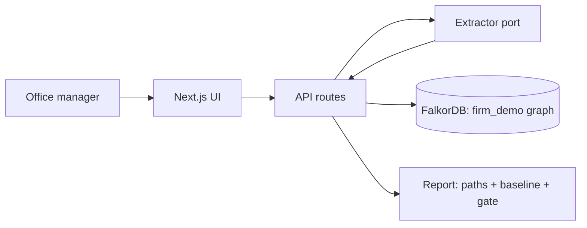

# Architecture

Clearance is a conflicts-of-interest gate for small law firms. The firm's history lives in a FalkorDB property graph. Intake text is turned into parties by an extractor, names are resolved against the graph by deterministic rules that fail closed, and bounded openCypher traversals draw every connection path up to three hops. A matter stays blocked until an attorney signs the drawn paths; signatures, ethical walls and alias resolutions are written back into the same graph. One Next.js deployable on Vercel. FalkorDB is the only datastore.

## Components

| Component | Responsibility | Tech | When it fails |
|---|---|---|---|
| Web app + API | UI (queue, intake, matter, ask, about) and route handlers | Next.js 16, TypeScript, Tailwind | Vercel error page; `/api/health` reports graph state |
| Graph layer | connection handling, `roQuery` (3 s timeout, bounded reads), write ops | `falkordb` npm 6.8.0 | fails closed: everything blocked, banner shown |
| Entity resolution | exact normalized match auto-matches; near-matches (surname + initials, whole-word containment) block and ask | pure TypeScript, no model | an unresolvable name keeps the matter blocked |
| Path engine | conflict paths up to 3 hops, wall enforcement, name-search baseline | openCypher | a query error blocks the matter, never clears it |
| Extractor port | parties and roles from intake text | `LLMExtractor` (Anthropic) or `MockExtractor` (deterministic), selected by `EXTRACTOR` | refusal, malformed output, timeout or quota all land as "blocked: extraction unavailable" |
| Corpus generator + loader | synthetic firm with planted conflicts, idempotent `UNWIND ... MERGE`, reset | TypeScript script, seeded RNG | regenerate; it is deterministic |
| Eval script | planted-conflict recall, graph vs literal name search | `npm run eval` | n/a (read-only) |

## Data flow

## External services

| Service | Used for | On failure | Limits |
|---|---|---|---|
| FalkorDB Cloud (or local Docker) | the only store | fail closed: banner, nothing clears, health route reports it | free tier |
| Anthropic API | party extraction only | falls back to blocked-with-reason; `EXTRACTOR=mock` runs with no key at all | capped at 20 LLM calls/day in the deployed demo |
| Vercel | hosting | README carries local run instructions | 4.5 MB request body (not reached) |

## Key decisions

Full records live in [docs/memory/decisions/](docs/memory/decisions/); failures that shaped the design are in [docs/memory/failures/](docs/memory/failures/).

- **ADR-0001** One Next.js deployable with the `falkordb` npm client, instead of a separate Python service. A judge opens one URL.
- **ADR-0002** Extractor behind a port with a deterministic mock. The demo spends no credits, the fails-closed paths are testable, and an API key can arrive late without blocking the build.
- **ADR-0003** Custom SVG path cards instead of a graph-viz library. Paths are at most three hops; drawing them by hand gives full control of the judged visual with no heavy dependency.
- **ADR-0004** Fails-closed gate semantics everywhere. Uncertain identity blocks. Infrastructure down blocks. This is the product's safety claim, so it is also the demo's staged failure.
- **Resolution is lexical rules, not embeddings.** The first version used small hash embeddings for name similarity; at realistic directory sizes (about 120 names) unrelated names scored 0.78 to 0.93 and the matcher was unusable (failure record F-0003). It was replaced with exact normalized matching plus two explainable near-match rules, and nothing inexact ever auto-matches.

## Failure boundaries

Extractor down: intake degrades to "blocked, retry". Graph down: the app goes read-only with a banner and nothing clears. No retries that could double-write: the decision endpoint is idempotent (matter state is checked first) and the loader is MERGE-idempotent. The model can propose parties; it can never clear a matter.

## Deployment

Vercel, production only. Secrets live in Vercel env vars (`FALKORDB_URL`, `ANTHROPIC_API_KEY`, `EXTRACTOR`, `RESET_TOKEN`); none are in the repo. Deploy with `vercel deploy --prod`. Rollback is Vercel's previous deployment. Seed or reset the demo firm with `npm run seed` or `POST /api/admin/reset` (token-gated).

## Observability

Structured console logs per API route (Vercel logs), `/api/health` (graph ping plus extractor mode), and the eval table in the README.

## Known tradeoffs

No auth: it is a single synthetic demo firm and judges should not have to sign in. Integration tests need a live FalkorDB; unit tests cover the pure logic without one. Traversals stop at three hops on purpose: for this decision a longer chain is noise.
