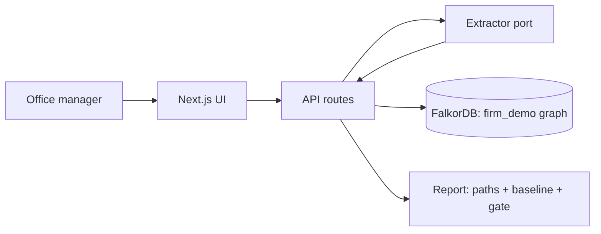

# Architecture — Clearance

Mode: hackathon. Last structural change: 2026-10-15 (ADR-0001..0004).

## Overview
Conflicts-of-interest gate for small law firms. The firm's history is a FalkorDB property graph; intake text is LLM-extracted into parties; entity resolution fails closed; deterministic k≤3 Cypher path queries decide conflict/clean; matters stay blocked until an attorney signs; signatures, walls and aliases write back. One Next.js deployable on Vercel; FalkorDB is the only datastore.

## Components
| Component | Responsibility | Tech | Why it exists (requirement) | When it fails |
|---|---|---|---|---|
| Web app + API | UI (queue, intake, matter, ask) + route handlers | Next.js 16, TS, Tailwind | MUST journeys J1–J3; Rule 10 live deployment | Vercel error page; health route |
| Graph layer | connection, `roQuery` (3 s timeout, LIMIT), write ops | `falkordb` npm 6.8.0 | Rule 2/3: graph is the product's core | fails closed: everything blocked + banner (AC on offline state) |
| Path engine | k≤3 conflict paths, wall enforcement, baseline name-search | openCypher | AC-1/2/6; the wedge | query error ⇒ blocked, never cleared |
| Extractor port | parties from intake text; name embeddings | `LLMExtractor` (Anthropic) / `MockExtractor` (deterministic) | AC-3/4; A-2 key gap; credit-safe demo | refusal/malformed/timeout/quota ⇒ blocked "extraction unavailable" |
| Corpus generator + loader | synthetic firm, planted conflicts, idempotent UNWIND…MERGE, reset | TS script, seeded RNG | Rule 6; AC-8/12 | regenerate (deterministic) |
| Eval script | planted-conflict recall: graph vs name baseline | TS script | AC-8; README table; H30 one command | n/a (read-only) |

## Data flow

## External services
| Service | Used for | Failure mode | Fallback | Limits |
|---|---|---|---|---|
| FalkorDB (Cloud free tier or Docker) | the only store | unreachable/timeout | fail closed; banner; health | free-tier limits unverified (A-1) |
| Anthropic API (or AI Gateway) | extraction + embeddings | refusal/malformed/timeout/quota | MockExtractor (`EXTRACTOR=mock`); 20 calls/day cap live | key pending (A-2) |
| Vercel | hosting | deploy/runtime errors | local run instructions (Rule 10 allows) | 4.5 MB body (fine) |

## Key decisions
- ADR-0001 Next.js single deployable on Vercel + falkordb npm client (vs FastAPI/Python second service): one deployable, judge opens one URL.
- ADR-0002 Extractor behind a port with deterministic mock (vs LLM-only): credit-safe demo, testable fails-closed paths, key can arrive late.
- ADR-0003 Custom SVG path cards (vs graph-viz library): paths are ≤3 hops; full control of the judged visual; no heavy dep. FalkorDB Browser covers the whole-graph view in the demo.
- ADR-0004 Fails-closed gate semantics everywhere (uncertain ⇒ blocked; infra down ⇒ blocked): control-and-safety criterion; the one staged failure.

## Failure boundaries
Extractor down → J1 degrades to "blocked, retry"; graph down → app read-only banner, nothing clears; Vercel down → local setup instructions in README. No retries that could double-write: decision POST idempotent (matter state checked), loader MERGE-idempotent. The model can populate the graph, never clear a matter.

## Deployment
Vercel (prod only, hackathon). Secrets: Vercel env (`FALKORDB_URL`, `ANTHROPIC_API_KEY`, `EXTRACTOR`, `RESET_TOKEN`). Deploy: `vercel deploy --prod` after gates. Rollback: Vercel previous deployment. Seed/reset: `POST /api/admin/reset` (token).

## Observability
Structured console logs per API route (Vercel logs); `/api/health` (graph ping + mode); eval output in README.

## Known tradeoffs
No auth (single demo firm — judges must not sign in). Integration tests require a live FalkorDB (A-1): unit tests cover pure logic until the URL exists. Vector index optional in mock mode (alias logic still demonstrates resolution).
