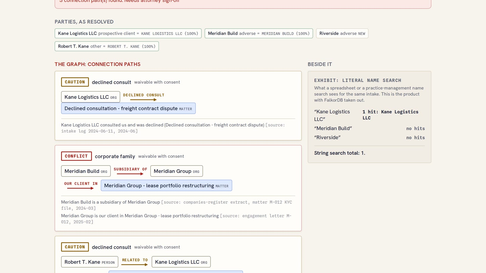
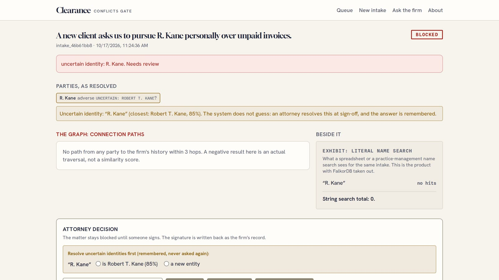
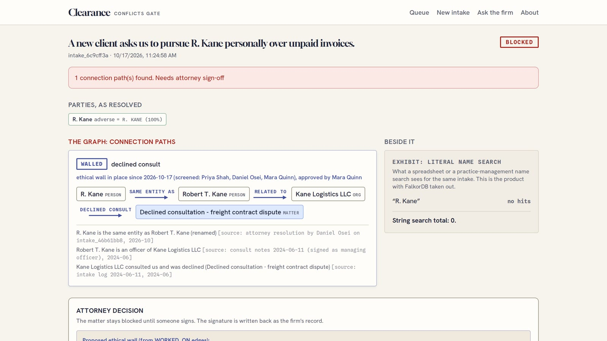
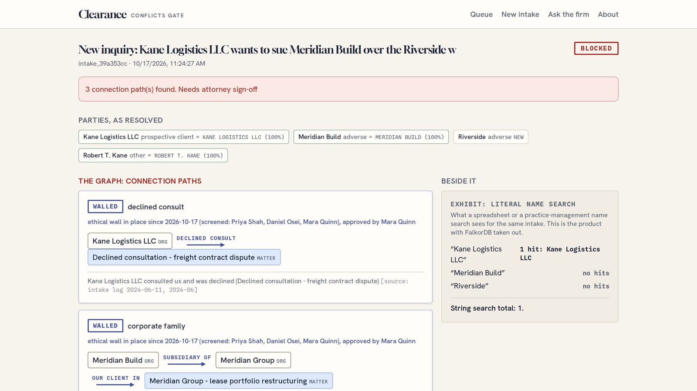
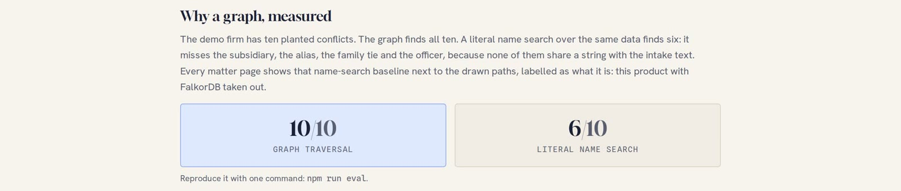

# Name search finds 6 of 10 conflicts. I built the graph that finds all 10.

*Clearance is a conflicts-of-interest gate for small law firms, built on FalkorDB in three days for Graph Hacks: Context for AI Agents (WeMakeDevs x FalkorDB, October 2026).*

Before a law firm takes a new client, someone has to answer one question: have we ever been on the other side?

Here is the case I built the demo around. An inquiry arrives: Kane Logistics LLC wants to sue Meridian Build over a warehouse contract. The office manager searches the firm's records for "Meridian Build" and finds nothing. On that name, the firm looks clear. It isn't. Meridian Build is a subsidiary of Meridian Group, and Meridian Group is a current client of the firm. The search could not see it, because "Meridian Group" appears nowhere in the inquiry. The connection exists only as a relationship.

Big firms buy software for this. Small firms mostly keep a spreadsheet, and the check is ctrl-F plus whoever has been at the firm longest. Missed conflicts are a leading cause of legal malpractice claims, and the dangerous ones have exactly this shape: a subsidiary, a renamed company, the officer of someone the firm turned away last year.

So I built Clearance. The firm's history lives in a FalkorDB graph, every new inquiry is checked by walking that graph, and the matter stays blocked until a lawyer signs the paths it drew.

- **Live:** [clearance-chi.vercel.app](https://clearance-chi.vercel.app) (opens signed out, with a seeded demo firm)
- **Code:** [github.com/itssaharsh/clearance](https://github.com/itssaharsh/clearance)



## A conflict is a path, not a string

The first decision shaped everything else. A conflict check that matches names can only ever find names. What I wanted to find was a chain: this new party is a subsidiary of that company, which is our client in that matter. That is a graph question, so the firm's memory became a graph. One FalkorDB graph per firm, with this model:

```
(:Person|:Org {key, name})        people and organisations
(:Attorney {key, name})           the firm's lawyers
(:Matter {key, name, year})       the firm's history
(:Intake {key, title, status})    new inquiries
(:Clearance {by, at, action})     a signed decision
(:Wall {by, at})                  an approved ethical wall

(a)-[:ALIAS_OF {source, since}]->(b)
(a)-[:SUBSIDIARY_OF {source, since}]->(b)
(a)-[:RELATED_TO {relType, source, since}]->(b)
(e)-[:CLIENT_IN|ADVERSE_IN|WITNESS_IN|DECLINED_CONSULT {source, since}]->(:Matter)
(:Attorney)-[:WORKED_ON {source, since}]->(:Matter)
```

Two choices in this model are worth copying.

**Every edge carries provenance.** `source` names the record that established the relationship and `since` says when. A verdict in Clearance is a path, and every hop of it cites its evidence: "Meridian Build is a subsidiary of Meridian Group [source: companies-register extract, matter M-012 KYC file, 2024-03]". A lawyer will not act on "the model thinks these are connected". A lawyer will act on a citation.

**The gate's own decisions are nodes.** Signed clearances, ethical walls and attorney resolutions are written into the same graph they were decided from. A decision you cannot query later is not a record.

## The query that does the work

The core of Clearance is one openCypher query. It walks one or two hops through identity and relationship edges, in either direction, then one hop into the firm's matter history (RETURN trimmed for space):

```cypher
MATCH p = (a {key: $key})-[:ALIAS_OF|SUBSIDIARY_OF|RELATED_TO*1..2]-(b)
          -[t:CLIENT_IN|ADVERSE_IN|WITNESS_IN|DECLINED_CONSULT]->(m:Matter)
WHERE id(a) <> id(b)
RETURN [n IN nodes(p) | n.name] AS nodeNames,
       [r IN relationships(p) | r.source] AS relSources,
       m.name AS matter, type(t) AS terminal
LIMIT 50
```

That caps a path at three hops, on purpose. For this decision a six-hop chain is not a weak signal. It is noise a lawyer would laugh at. The `WHERE id(a) <> id(b)` line exists because a variable-length path can loop back to where it started. My first version wrote `WHERE a <> b`, which FalkorDB rejects, so the comparison is on node ids.

Every read goes through `GRAPH.RO_QUERY` with a timeout, and a guard refuses any query without a `LIMIT`. A lint script fails the build if any file talks to the graph outside the one module that enforces this.

A second query runs beside the traversal, and it is deliberately weak: a literal name search over the same data. Every matter page shows its result next to the drawn paths, labelled as what it is, the product with FalkorDB taken out. In the hero case the graph draws three paths and the name search finds one hit.

## The model proposes. The graph decides.

There is an LLM in the pipeline, and it has exactly one job: reading party names and roles out of a messy intake note. The live demo runs Qwen2.5-72B through Featherless for that. Behind the same interface sits a deterministic extractor, so every test is replayable and the product runs with no API key at all. It also takes over whenever the model has not answered within 10 seconds.

Everything after extraction is model-free. Entity resolution is three rules you can read in one sitting. An exact normalized name is the only automatic match. A shared surname with compatible initials, or an organisation name whose every word appears in a record, makes the gate ask a human. Anything else is new. The verdict is the traversal above.

And the gate fails closed. An uncertain identity blocks the matter. A graph that is down blocks every matter. A clear with unresolved uncertainty is refused by the server. The model cannot talk the gate open, because the gate never asks the model anything.

Here is the staged failure from the demo. The intake says "pursue R. Kane personally". Is that the Robert T. Kane the firm already knows?



Clearance does not guess. It blocks the matter and asks an attorney, once.

## Memory is a write to the graph

When the attorney answers, the answer becomes an edge:

```cypher
MATCH (c {key: $canonicalKey})
MERGE (a:Person {name: $aliasName})
ON CREATE SET a.key = $aliasKey
MERGE (a)-[r:ALIAS_OF]->(c)
SET r.source = $source, r.since = $since
```

Its `source` reads "attorney resolution by Daniel Osei on intake_…". Run the same intake again and nobody is asked anything. "R. Kane" now resolves at 100%, and the graph follows the new edge all the way to a consultation the firm declined in 2024: R. Kane is the same entity as Robert T. Kane, who is an officer of Kane Logistics LLC, which the firm turned away. That path did not exist until a human answered one question.



Ethical walls work the same way. Clearance proposes who must be screened by reading `WORKED_ON` edges from the implicated matters. When an attorney approves, a `Wall` node is written with `SCREENED_BY` edges to the people and `AROUND` edges to the matters, and every later check that touches those matters shows the standing wall instead of a raw conflict.



This is the part I would defend hardest. Agent memory usually means text in a context window. Here memory changes future verdicts, for every attorney at the firm, and each piece of it says who decided it and when.

## What went wrong (the useful part)

**The matcher that collapsed at 120 names.** My first entity resolution used tiny 16-dimension character-bigram hash embeddings: auto-match at 0.95 cosine, ask a human from 0.78. Unit tests on two-entry directories passed. Then I ran it against the full seeded directory of about 120 names, and unrelated names scored 0.78 to 0.93 against each other. "Riverside" against "Granite Row Outfitters" scored 0.93. The demo would have drowned in false identity questions, and auto-match was one unlucky string away from silently merging two strangers, in a product whose whole claim is that it fails closed. I deleted the embeddings and wrote the three lexical rules above. The lesson went into the repo's failure log: calibrate any matcher against a production-sized directory, and never let a similarity score auto-match in a system that promises to fail closed.

**My demo video found a production bug.** The day before submission, the screen recorder for my demo video kept freezing on "Reading the intake…". The server log said `read ETIMEDOUT`: the connection to FalkorDB Cloud had gone silent. I had set `TIMEOUT: 3000` on every query and assumed I was covered. I was not. That timeout is enforced by FalkorDB itself, and a dead socket never delivers a reply, so the request simply waited. The client also reported the socket error as an `error` event that nothing was listening to. On the live site, a judge could have hit a stale connection and watched a spinner for minutes, in a product that promises "graph down means blocked, with a banner".

The fix is a client-side deadline on every query, plus dropping the cached connection on any socket error:

```ts
function withDeadline<T>(p: Promise<T>): Promise<T> {
  let timer: ReturnType<typeof setTimeout> | undefined;
  const deadline = new Promise<never>((_, reject) => {
    timer = setTimeout(() => {
      resetClient();
      reject(new GraphUnavailableError(`no reply within ${CLIENT_DEADLINE_MS} ms`));
    }, CLIENT_DEADLINE_MS);
  });
  return Promise.race([p, deadline]).finally(() => clearTimeout(timer));
}
```

The test that proves it starts a TCP server that accepts the connection and never answers, which is what a dropped cloud connection looks like from the client's side. Without the fix the test hangs past its 15-second limit. With it, the query fails closed inside the deadline, and the next query reconnects to the real database and succeeds.

**The eval that printed PASS and never exited.** `npm run eval` printed its table, printed PASS, and then sat there until my harness killed it at 1,800 seconds. The FalkorDB client keeps its socket open, and an open socket keeps Node's event loop alive. Every CLI entrypoint now closes the client and exits explicitly, and the eval finishes in about six seconds. The embarrassing part: my first patch for it printed "exit added" without checking whether the change had been applied. It had not.

**Smaller fights:**

- My `falkors://` TLS connection to the free tier did not fail, which would have been kind. The handshake just hung. Plain `falkor://` connected at once.
- Turbopack tried to bundle the client and the build died with `a.BigInt is not a function`. Listing `falkordb`, `redis` and `@redis/client` in `serverExternalPackages` fixed it.
- Two integration test files ran in parallel, and each reset the shared cloud graph the other was reading. One line in the vitest config: `fileParallelism: false`.
- My own mock extractor cut "pursue R. Kane" off at the period after the R, because the sentence splitter thought the sentence had ended.
- On the last morning, the first check after the site sat idle came back "extraction unavailable: timeout". The provider had unloaded the 72B model overnight, and reloading it took longer than my 20-second limit. A loaded model answers in about 3 seconds, so the live extractor now waits 10 and then hands the intake to the deterministic extractor. Extraction only proposes names, so the gate is no weaker for it.

## Measured: 10 versus 6, and what that does not claim

The demo firm has ten planted conflicts. The graph finds all ten. A literal name search over the same data finds six. The four it misses are the subsidiary, the alias, the family tie and the officer, and none of them shares a string with the intake text, so no amount of effort on search would recover them. `npm run eval` reproduces the table against a live graph in seconds.



The firm is synthetic, because real conflicts data is confidential by nature and the event rules bar it anyway. The corpus is seeded and deterministic, and the planted conflicts are listed in a public manifest in the repo. So 10/10 versus 6/10 is a demonstration, not a benchmark. It shows four structural conflict types that a string search cannot represent, on data built to contain them.

## What I'd tell you if you're building on a graph

- Put provenance on every edge from day one. It costs two properties, and it turns every answer into a citation.
- Write decisions back as nodes. That is what turns a query tool into a system with memory.
- Never let a similarity score auto-match anything a human has to defend. Make "close" ask.
- Give every database call a client-side deadline. A server-side timeout cannot help you once the socket is gone.
- Put the baseline inside the product. The name-search exhibit beside the drawn paths made the case for the graph better than any slide could.

## What it doesn't do

It runs on one synthetic firm. Traversals stop at three hops. There is no sign-in, by design, so judges can open it. Extraction only proposes names. It is a hackathon build, not legal advice and not a system of record.

## Try it

Open the live app, go to New intake and run "Ambiguous name". Watch the gate refuse to guess who R. Kane is. Answer the question once, run the same intake again, and watch it never ask you again.

- Live: [clearance-chi.vercel.app](https://clearance-chi.vercel.app)
- Code, graph model and every query in this post: [github.com/itssaharsh/clearance](https://github.com/itssaharsh/clearance)

Built solo in three days, with Claude Code as a pair programmer. The decision records and failure log from the build are in the repo under `docs/memory`.
